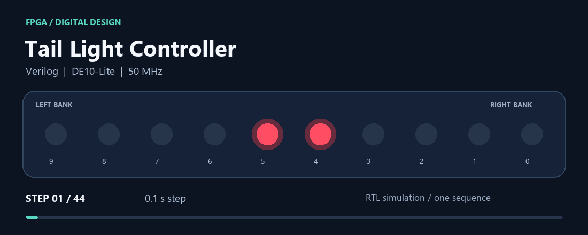
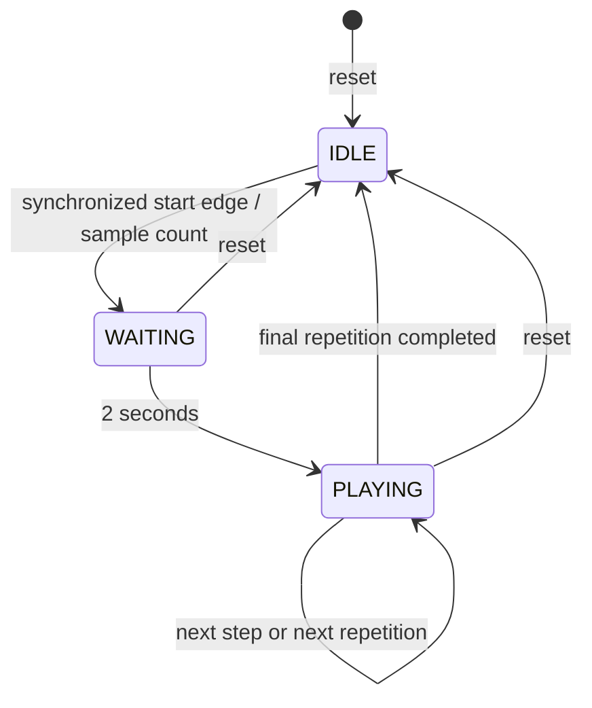

# FPGA Tail Light Controller

[](https://github.com/jinyang10/fpga-tail-light-controller/actions/workflows/verify.yml)


A 44-step LED sequencer built in Verilog for the DE10-Lite FPGA. It starts on a button press, waits two seconds, then plays the pattern between one and ten times. A seven-segment digit shows how many repetitions remain.



*One complete sequence, rendered from simulation with the board's intended playback timing. This is a visual preview, not a recording of the physical board.*

## What it demonstrates

- A three-state FSM with cycle-based timing on a single 50 MHz clock.
- Two-stage synchronization and edge detection for the start button.
- A repeat counter that updates at sequence boundaries and survives reset.
- Independent masking of the left and right LED banks.
- A self-checking testbench, GitHub Actions, and a reproducible Quartus build.

**Verified locally:** 54,568 checks across 57 complete sequences, including every repeat count from 1 to 10. The Quartus build uses **183 / 49,760 logic elements** and meets the **20 ns internal clock constraint**. See [verification results](docs/verification.md) for the scope and timing exceptions.

## Try it

### Run the simulation

Install [Icarus Verilog](https://steveicarus.github.io/iverilog/usage/installation.html) and Python 3.10 or newer. On Ubuntu:

```bash
sudo apt-get install iverilog
git clone https://github.com/jinyang10/fpga-tail-light-controller.git
cd fpga-tail-light-controller
python3 scripts/test.py
```

The test prints `PASS` and writes `build/iverilog/tail_light.vcd`. Open the waveform with GTKWave. If the executables are outside your PATH, use `python scripts/test.py --bin PATH_TO_SIMULATOR_BIN`.

### Run on the board

1. Open `fpga/tail_light.qpf` in Quartus Prime Lite with MAX 10 device support. This project was built with version 25.1std.
2. Confirm the device matches your board. The supplied lab project targets `10M50DAF484C6GES`; another board revision may need a different device selection.
3. Compile, then use Quartus Programmer and USB-Blaster to load `build/quartus/tail_light.sof`.
4. Press and release **KEY0** to reset. Leave **SW9** and **SW0** down, then press **KEY1** to start.

**KEY0** stops playback immediately and preserves the displayed count. **KEY1** starts a new run when idle. **SW9** hides the left five LEDs; **SW0** hides the right five. Count ten is shown as **A**. Other switches are unused.

For a command-line build:

```bash
cd fpga
quartus_sh --flow compile tail_light
```

## How it works



The sequence has 42 short steps of 0.1 seconds and two holds of 1 second, for **6.2 seconds per repetition**. The startup delay happens once per run, so a run lasts **2 + 6.2N seconds**, excluding button synchronization latency.

The repeat selector cycles from 1 to 10 on every clock and is sampled when the start edge is accepted. Its result depends on press timing; it is **not a true random-number generator**.

## Project files

```text
rtl/       Synthesizable controller
tests/     Self-checking SystemVerilog regression
fpga/      Quartus project, board pins, and timing constraints
scripts/   Test runner and simulation preview renderer
docs/      Design notes, verification results, and preview assets
```

Read the [design notes](docs/design.md) for reset behavior and tradeoffs, or the [verification notes](docs/verification.md) for the test scenarios and build evidence.

## Scope

This started as my EECS 2316 Lab 3 project. The portfolio version keeps the LED sequence and control behavior, adds configurable timing for tests, and cleans up the Quartus project. The display decoder uses a continuous assignment so its initialized value is also visible at the start of simulation.

The start synchronizer does not debounce the button. Reset release is asynchronous, and switch changes can briefly glitch the combinational LED output. This is an educational FPGA demo; physical-board validation of this repository revision is still pending.

**Author: Jin Yang** · [GitHub](https://github.com/jinyang10)
